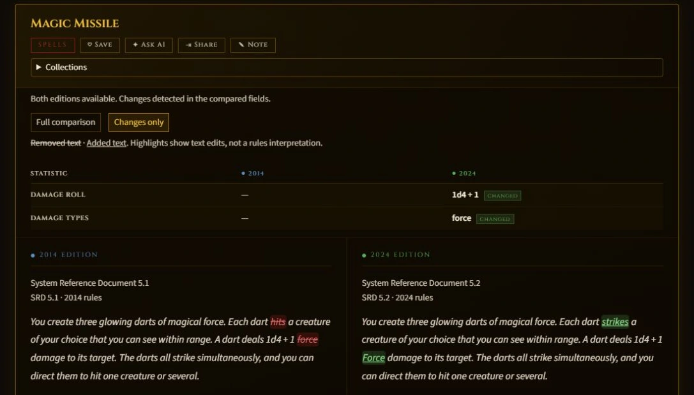
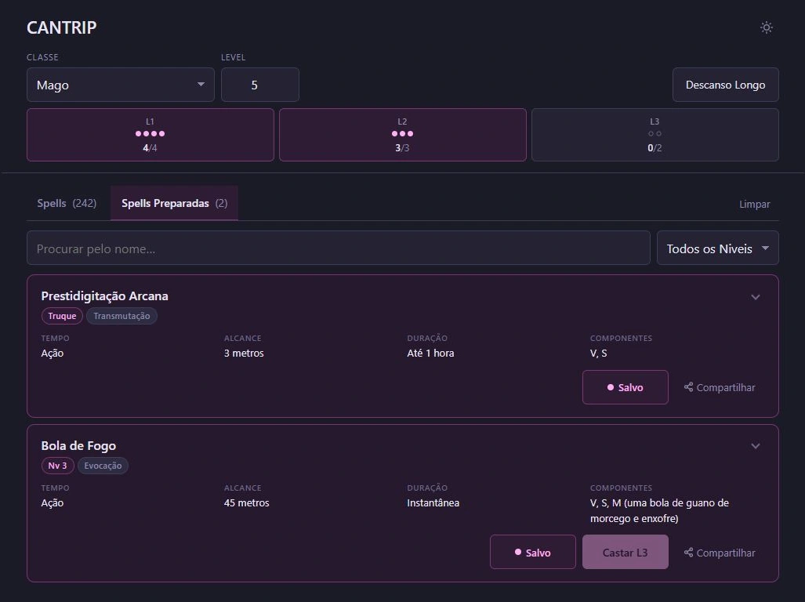
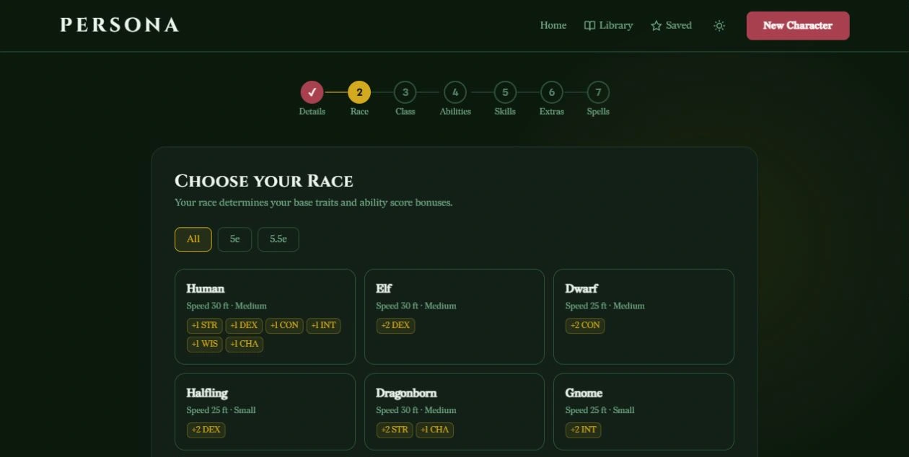
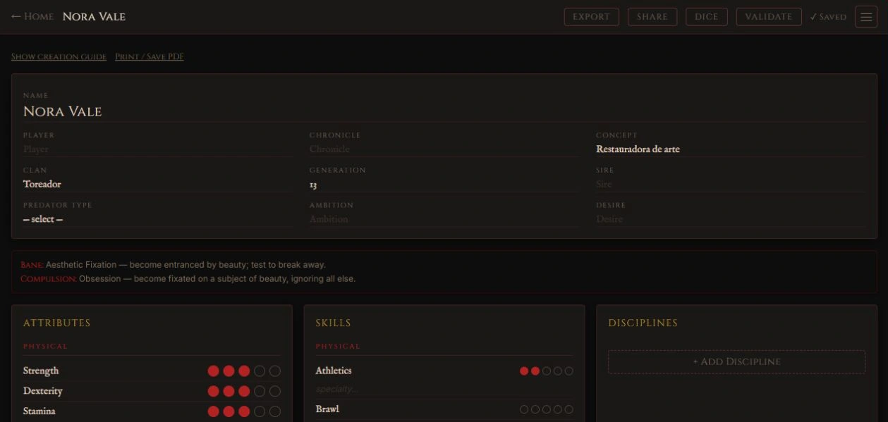
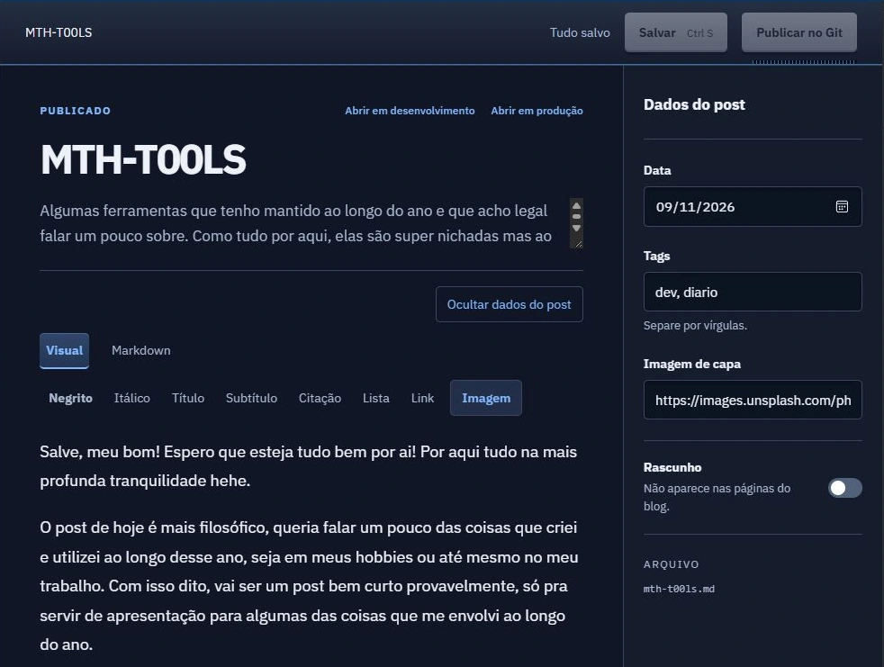
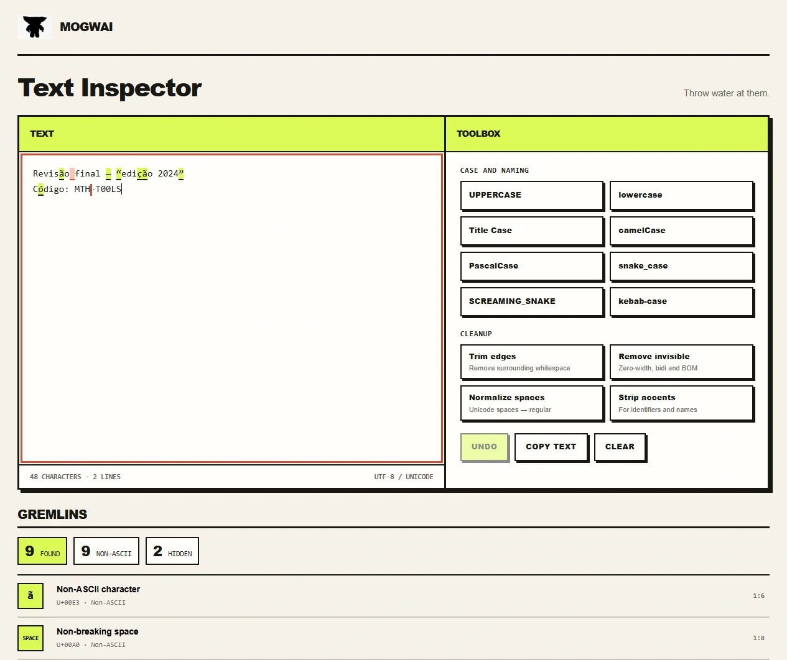
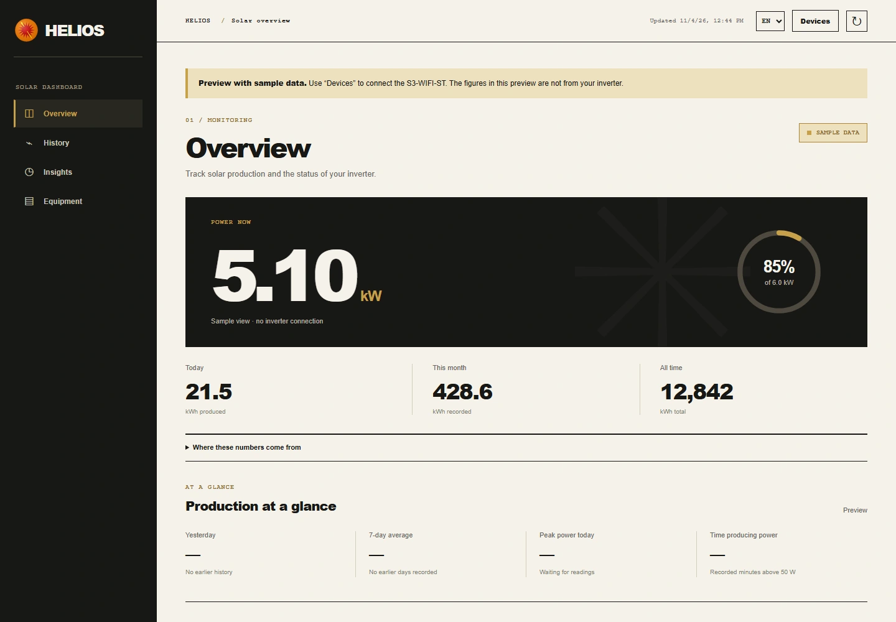
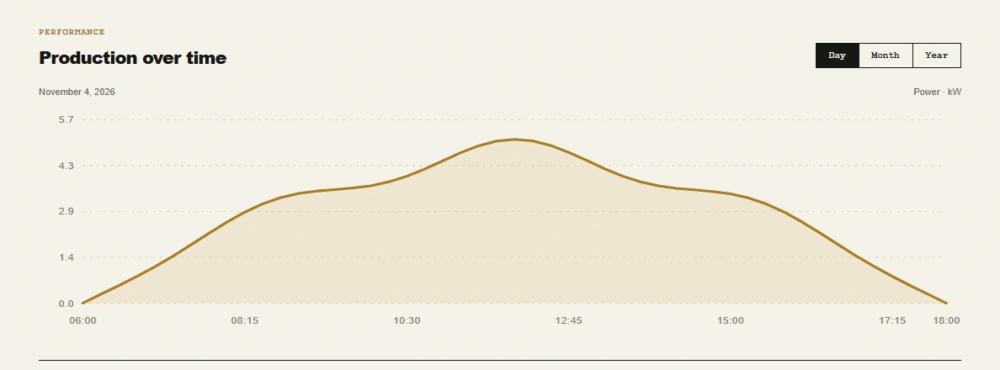

Salve, meu bom! Espero que esteja tudo bem por ai! Por aqui tudo na mais profunda tranquilidade hehe.

O post de hoje é mais filosófico, queria falar um pouco das coisas que criei e utilizei ao longo desse ano, seja em meus hobbies ou até mesmo no meu trabalho. Com isso dito, vai ser um post bem curto provavelmente, só pra servir de apresentação para algumas das coisas que me envolvi ao longo do ano.

*Importante ressaltar que não vai ter nenhuma ordem especifica por aqui, somente a memoria mesmo 🤣.*

### *Tome of Changes*

[https://github.com/matheusdmm/Tome-of-Changes](https://github.com/matheusdmm/Tome-of-Changes)  

O Tome of Changes é uma aplicação que fiz para utilizarmos nas nossas seções de DnD em um período onde estávamos migrando da 5e para a 2024 e mesmo com os livros atualizados (alou editora Asmodee), ainda assim era bem arduo ficarmos procurando todas as coisas e pausando a aventura. 

Logo, a coisa mais logica seria implementar um diff viewer entre a 5e e a 2024 e com isso ao procurarmos uma spell, efeito ou qualquer outra coisa, veríamos em um lado a descrição da 5e e do outro lado a 2024 e todas as alterações em tela (semelhante ao diff do git).

A aplicação em si foi feita com Vue e tailwind, estava um pouco saturado de React nesta época.

### Cantrip

[https://github.com/matheusdmm/CANTRIP](https://github.com/matheusdmm/CANTRIP)  

Seguindo o baile, também fiz o Cantrip que é basicamente um spellbook pros personagens. Ele funciona como grimorio onde tu pode preparar as magias e favoritar as coisas e ao mesmo tempo verificar quantos slots tem disponível de  cada nível. Assim sabe exatamente quantos e quais recursos ainda tem. 

Funciona como webapp favoritado no celular e o intuito é justamente esse. Também roda local com o local storage caso não tenha dados moveis na seção. 

Foi feito usando Gleam e Alpinejs, foi muito interessante aprender Gleam e Glimr, quero fazer mais algumas coisas usando Gleam e entender melhor o mundo da programação funcional. Inclusive o mano que desenvolve e mantem o framework Glimr (Miguel J Arias) me segue no github e eu acho massa demais isso heh.

### Persona

[https://github.com/matheusdmm/Persona](https://github.com/matheusdmm/Persona)  

Seguindo a linha de ferramentas até então apresentadas, o Persona é um kit para criação de personagens/ficha de aventura pro 2024. Tenta ser um tutorial meio interativo simulando a experiencia do Baldurs Gate 3. 

Não é perfeito mas dá pra fazer uns personagens bem legais, ele tem toda a logica de rolagem e de pontos embutida então fica mais ou menos parelho o personagem (mesmo pra quem nunca jogou). Outro ponto legal é que ele se conecta com algumas APIs externas para buscar equipamentos e itens, então fica tudo bem pronto pro jogador começar a aventura.

Usei Vue, Tailwind e Go pra fugir um pouco do padrão. O Tailwind hoje em dia seria praticamente desnecessário, mas o Go para validações (Usando Echo 5) e o Vue 3 na interface achei bem interessante. 

O ponto mais interessante é que no final a ficha gerada é um pdf a4 pronto para impressão. Totalmente estilizado.

### Night-creatures

[https://github.com/matheusdmm/night-creatures](https://github.com/matheusdmm/night-creatures)  

Em certo período do ano eu senti vontade de jogar uma aventura de Vampiro, infelizmente fui o único que teve essa vontade 🤣, logo tive que usar um agente para mestrar as seções (Caso queira ver mais sobre, let me know) e aproveitando esse delírio, eu acabei desenvolvendo esse criador de fichas (que é bem menos rebuscado que o Persona). 

Ele roda com React e Python/Fastapi e tem interatividade em tempo real, já que estava jogando in box para adicionar ou remover status dependendo das rolagens/fome mas isso não impede de se imprimir a ficha gerada e uma folha a4 ou pdf.

### Typewriter

[https://github.com/matheusdmm/Typewriter](https://github.com/matheusdmm/Typewriter)  

Aqui é o editor de texto/markdown que uso pra escrever meus posts, super simples e direto ao ponto. Tem um campo de texto com edição rich text (quaaaaase), seção para gerenciar tags, escolher a pasta do Astro com os posts e também a seção de publicar novas imagens no /img. 

Tem alguns recursos legais pra qualidade de vida e me permite focar na escrita quase como se tivesse escrevendo no meu blog lá em 2009 na falecida Uol ZipNet.

Concebi o editor em typescript e bun pra rodar num server local mas aos poucos comecei a portar ele pra Go e Wails, tentando ter uma experiencia mais nativa/modo janela. Acho que até metade de novembro concluo isso. 

Também coloquei uma engine de temas em css para dar uma diferenciada na estética conforme vou escrevendo heh.

### Mogwai

[https://github.com/matheusdmm/Mogwai](https://github.com/matheusdmm/Mogwai)  

Esse aqui é interessante pois resolve um dos casos de uso real no meu trabalho que é: Pessoas de todos os lugares do mundo me enviam textos e informações e em muitos destes casos eles vem em formato fora do utf8 ou do ascii, o que pode causar bastante problema dependendo do local que essa informação vai ser inserida. 

Eu já conhecia a extensão "Gremlins" no VS Code, então tentei replicar a usabilidade dela em uma aplicação web relativamente simples, onde colava o texto e já via o que tem de errado com o texto ou se ele está seguro para ser utilizado. 

Como é uma aplicação estática e tem um total de zero pacotes processados em servidor, upei ela na minha VPS e todos podem utiliza-la. Caso necessário, o código é aberto e simples para auditar ou rodar localmente. Win-Win situation.

HTML, CSS e Javascript baunilha.

### Helios

[https://github.com/matheusdmm/Helios](https://github.com/matheusdmm/Helios)  

Hélio de acordo com os gregos era o titã que tinha como personificação o sol, alguns milênios depois, este mesmo titã aquece a minha casa e me fornece energia sustentável. O problema é que não tinha como mesurar a eficiência com a qual esta energia estava sendo fornecida através das minhas placas solares. 

Utilizando um pouco do tempo livre do meu estagiário Claudio Códigos e uma engenharia reversa do bem depois de um tempo observando o meu inversor Solis, conseguir interpretar os pacotes do logger e exibir eles em uma dashboard simples mas eficiente em me mostrar os KW/h diários gerados.   

E tudo isso começou porque precisava ter uma média de eficiência antes e depois da limpeza das placas.

Agora posso ter uma estimativa da próxima semana com base em um forecast, salvar e importar um csv com os dados gerados até o presente momento e também verificar a temperatura e status geral das placas e do inversor. Tudo isso de maneira relativamente eficiente, visto que a alternativa seria um serviço pago pela empresa que instalou as placas.

### Por enquanto é isso

Valeu demais, continua arrasando 🤘- Matheus.
