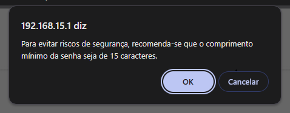

Boas, meus caros conterraneos da rede mundial de computadores que está se tornando uma camara de eco, espero que estejam bem!

Hoje quero trocar uma ideia curta porém interessante sobre uma sucessão de bagulhos estranhos nas ultimas semanas...

### Uma terça feira qualquer, cerca de 10:00 da manhã.

Estou na minha série matinal de reuniões(umas 4 ou 5 geralmente), minha internet decide boicotar o meu acesso. Me conecto na reunião via Teams, fico cerca de um minuto e meio conectado. A conexão começa a falhar até que eventualmente... nada, ela cai. Fico cerca de uns 30 segundos fora e retorno. Então o ciclo se repete. Estou **muito puto** com a situação, principalmente pelo fato de que nesta call em especifico eu preciso compartilhar a tela e liderar algumas ações. 

*Respiro fundo.*

Digamos que meu provedor neste momento era algo análogo ao ato de iluminar ou afirmar algo. Usava tecnologia um tanto quanto jurássica mas costumava funcionar bem, e como já devem saber, eu não me oponho ao antigo. Pedais analógicos, amplificadores valvulados, câmeras de filme, carro velho, tudo isso já faz parte dos meus hobbies então... Nada contra.

Após contornar a situação usando o 5G do meu celular, consegui trabalhar em paz (mas ainda puto). Fui fazer uma pesquisa rápida no reclame aqui, verificar com alguns amigos sobre provedores locais e cheguei a uma conclusão.

Fiz uma contratação neste mesmo dia para um provedor que é análogo ao ato de respirar e executar ações funcionais risos. Fibra ótica, velocidade nominal de download e upload bem superiores ao que estava acostumado, um upgrade bem interessante. 

A burocracia passa, é marcada a data da instalação.

### Alguns dias depois, dia da instalação

O técnico vem pontualmente no horário marcado. Realiza a passagem do cabeamento pelo sótão da casa, faz os procedimentos de instalação dos cabos, cortes e acabamentos. Cerca de umas duas horas mais ou menos. O horário do almoço chega e o resto do trabalho fica para o turno da tarde.

A tarde chega, o modem é instalado. Meu computador faz o aperto de mão digital via cabo RJ45 CAT6 entre meus arquivos locais e a grande rede mundial de computadores. Viva a computaria.

Entro no speedtest, cerca de 620mbs de download e 300 e poucos mbs de upload. Nada mal. Repito o teste no fast e é um resultado bem semelhante. Temos progresso.

Entro no CS2, cerca de 17ms de ping, muito menos do que estava habituado. O mesmo padrão se repete em outros testes. Faço uma chamada de testes, funciona de maneira satisfatória. 

Me dou por satisfeito, vou concluir algumas tarefas de casa e depois jogar um futebolzinho, afinal não sou de ferro. 

Quando retorno, cerca de umas 18:30, vou terminar de fazer as configurações do wi-fi e ajustar todos os bagulhos IoT que tenho, incluindo as placas solares.

Neste momento estamos adentrando a singularidade.

### Uma ode aos usuários que são tratados como bebes e um brinde a quem é lunático o suficiente pra subverter isso

*Neste momento, meus caros, peço que coloquem Pawn Shop do Sublime para lerem este trecho.*

Justamente na parte mais importante eu descubro que a fabricante do firmware do novo modem pensa que todos os usuários são idiotas ou possivelmente idosos não funcionais que rezam pra pneu. 

Existe uma validação de caracteres para a senha do teu wi-fi.

Eu. Não. Tô. Brincando. Maninho.

```
Sua senha deve ter:
10 ou mais caracteres
No mínimo uma letra
No mínimo um número
Nível de segurança: meio

Evite senhas usadas em outros sites ou que sejam fáceis de adivinhar
```

Palavras vindas direto do painel de administrador.

Ai Você deve tá se perguntando: "Tá, mas não é só colocar uma senha melhor e vraaaau?". Claro que não, vou ter que reconfigurar todo o sistema das placas solares, incluindo o dashboard que faz a analise das métricas, as TV smart, os repetidor mesh, as caixa de som, o ar condicionado e a puta que pariu. A vontade de fazer isso tende ao negativo. 

Mas isso nem é o pior. Existe uma segunda pegadinha.

Se por acaso você decidir acatar o que a regra manda e fazer uma senha por exemplo "MinhaSenha1#", ainda assim vai triggar um popup falando que é **RECOMENDAVEL **ter pelo menos 15 caracteres. Vai ter um popup maligno com "OK" e "Cancelar". Caso clique no OK, ele vai injetar a quantidade que falta de caracteres com simbolos aleatórios para fechar os 15 e então salvar a senha.

  

PUTA QUE PARIU.

Minha senha não é fraca, tem cerca de 10 caracteres mistos com caracteres especiais e algumas outras bruxarias. De acordo com o https://www.passwordmonster.com, supostamente levaria cerca de 10 anos. Se é verídico ou não não sei e não quero testar. De qualquer forma, outra parte da configuração é com whitelist dos dispositivos específicos que acessam e habitam meu pequeno universo que chamo de casa. 

Os visitantes tem que sobreviver com uma outra rede secundaria especifica que não vem ao caso, mas quem que me visitaria sem ser para tomar café ou ver os meus gatos, não é mesmo?

Anyway, coloquei na minha cabeça que iria estudar essa monstruosidade e ver o que conseguia fazer para manter minha rede intacta com o menor esforço possível. Imagina uma padaria.

Aqui vai o que eu encontrei.

### Todo cadáver no Everest já foi um ser humano extremamente motivado

O firmware em si parece customizado para o vendor/operadora, tem algumas coisas especificas colocadas ali e analisando melhor o sistema, que na verdade é um front-end BEM jaguara com meia dúzia de configurações, descubro que a validação da senha é client-side only.

No HTML montado, o javascript é exposto e a função do botão de salvar chama a função **"showPassLevel()"**. Essa função roda um script que vai ler o campo **"txtPassword"** e ai fazer uma média do nível da tua senha, caso ela seja contraria a alguma da quelas regras ali de cima, ele não vai deixar tu salvar a senha. 

Não vou explanar muito e nem deixar o script aqui, mas digamos que se tu tem um pouco de maldade no coração, vai descobrir o caminho BEEEM rápido.

Com isso dito, tudo o que precisa ser feito agora é mostrar quem que manda com o bom e velho javascript. 

A função **showPassLevel()** é quem faz a média da senha digitada, como falei antes. então a gente pode só guardar a original e substituir por outra BEEEEM temperada no lugar. Ela continua fazendo a avaliação, mas, quando reconhece a senha que eu quero usar, devolve como valor 3 para a página, o que significa que a média é positiva para a senha passar e ser salva.

A maldade aqui é que a senha no campo em si não muda, o valor que a interface recebe é que é alterado. Ai é só salvar e ser feliz.

O lance é que depois que tu salva e a pagina é recarregada, essa função é perdida no horizonte de eventos javascripticos, então vai ter que fazer a mesma sacanagem para as outras áreas do sistema que também tem essa validação.

Pensa em algo mais ou menos nesse caminho aqui:

```javascript
(() => {
  const original = window.showPassLevel;
  window.showPassLevel = function (...args) {
    const resultado = original.apply(this, args);
    return document.querySelector('#txtPassword')?.value === 'MinhaSenhaFortissima'
      ? 3
      : resultado;
  };
})();
```

E é mais ou menos isso que é preciso, só injetar no console na pagina de troca de senhas e vai ficar tudo verdinho e quando salvar, sem popup e com a senha que gostaria.

Faço o possível para não ser um cadáver no Everest, mas as vezes a gente vai muito longe de casa pra continuar tendo o mínimo necessário.

### Final feliz

Acabo por aqui meu momento palestrinha, se leu tudo, muito obrigado! Se tu trabalhou nesse firmware, te agradeço também por não fazer validação direto no backend e se isso foi uma ideia vinda do time de produto, vai se fuder. 

O poder de decisão de segurança e de escolhas deve sempre ficar na mão do usuário, especialmente em hardware local. Os avisos são essenciais, mas impedir o usuário ou pelo menos não ter uma seção onde tu pode deliberadamente assinar que está ciente dos riscos é um padrão horrível.

Faça tudo o que quiseres, é tudo da lei.

### Por enquanto é isso

Valeu demais, continua arrasando 🤘- Matheus.
